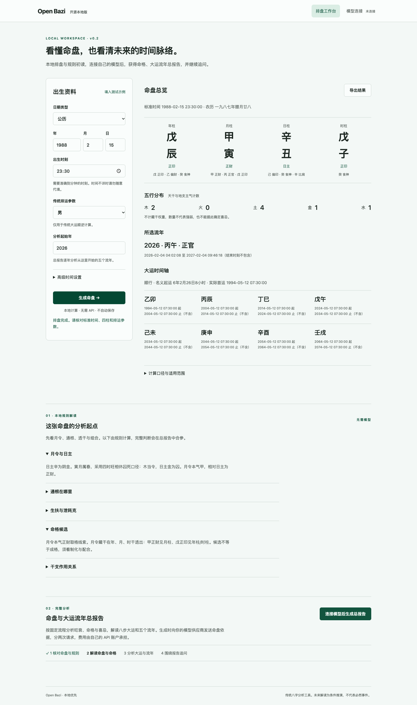

# Open Bazi

一个中文、开源、本地优先的八字分析工具。无需注册：离线排盘与规则初读，连接自己的模型后，生成命盘、命格、大运流年总报告，并基于固定流程继续追问。

**v0.2 将排盘、规则依据、完整报告和对话串成同一套 SOP。** 程序负责排盘与结构证据，模型在明确的传统规则下提出旺衰、命格、喜忌和未来趋势的条件判断。固定流程提高可核对性，不代表传统推演具有经过验证的预测能力。



## 已实现

- 公历与农历输入，农历闰月检查。
- 四柱、日主、十神、藏干、五行主气计数。
- 历史夏令时检查、重复时刻选择、标准时间核对。
- 大运方向、分钟制起运、实际起止日期及所选流年。
- DeepSeek、通义千问北京地域预设；自定义 Chat Completions 兼容接口。
- 填写 API Key 后，点击“测试并连接”。测试只发送简短请求，可能产生少量费用。
- 无需 API 的规则初读：月令、通根、透干生扶、格局候选与合冲刑害。
- 命盘六节分析：总论、旺衰、命格、喜忌、事业财富、情感相处。
- 八步大运、从所选年份开始的五个流年，以及未来重点与行动建议。
- 交运年按实际时刻分段，区分出生前、起运前、缺排运参数和超出八步大运范围。
- 基于报告的聊天：追问具体年份或未来数年，服务端重新计算相关流年，沿用同一命盘。
- 每节展示判断、依据、条件与建议；校验章节完整性、顺序及必需引用。
- 导出命盘、完整报告和对话为 JSON，不包含 API Key。

## 下载后运行

先安装 **Python 3.12 或以上版本**。下载 GitHub 的源码 ZIP 并解压，在项目目录运行：

```sh
python3 start.py
```

Windows 可运行 `py -3 start.py` 或双击 `start.bat`；macOS 可在授予执行权限后双击 `start.command`，也可使用上面的命令。

首次运行会创建独立环境并联网安装依赖，之后自动打开 **http://127.0.0.1:8765**。依赖默认保存在用户目录 `.open-bazi/venv`，不修改系统 Python。关闭终端或按 Ctrl+C 停止服务。

这不是免安装的桌面可执行程序。首版需要 Python；Windows 和 Linux 的实际桌面启动体验仍需更多用户反馈。macOS 已验证本机服务和浏览器流程。可以用 `OPEN_BAZI_VENV` 指定运行环境位置，用 `OPEN_BAZI_PORT` 修改端口。

首次安装失败时，请检查 Python、证书和可访问的 Python 软件源。安装完成后，不使用 AI 的排盘无需网络。

### Docker 可选

```sh
docker compose up --build
```

打开同一个本地地址。该配置将端口限制在本机；Docker 构建配置已提供，当前发布前未在 Docker 环境实测。

## 接入自己的 API

1. 打开“模型连接”。
2. 选择 DeepSeek 或通义千问，页面自动填入接口与模型名。
3. 在供应商处申请 Key 并确保账号有可用额度，再粘贴到页面。
4. 点击“测试并连接”。连接成功后返回排盘工作台，填写资料并点击“排盘并生成总报告”。
5. 报告按“命盘分析 → 大运流年”分两次调用生成，可切换总览、命盘、大运、逐年分析。
6. 在报告下方提问，例如“未来三年的事业重点是什么？”或“2035年的关系与合作要关注什么？”。

如果先离线排盘，连接模型后点击“生成总报告”即可。第二步失败时，已完成的命盘分析会保留；点击“继续生成大运流年”只重试第二步。完整报告重复续接不会再次调用模型。主动重新生成总报告则会重新计费。

通义预设使用北京地域现有接口，Key 必须与地域一致。需要业务空间专属地址时，选择“自定义兼容接口”。自定义地址填写 API Base URL，支持的完整 `/chat/completions` 地址会自动去掉末尾路径。自定义服务需支持相应 Chat Completions 请求和 JSON 输出；HTTP 仅允许本机地址，远程必须 HTTPS。

预设依据：[DeepSeek 官方接入文档](https://api-docs.deepseek.com/)、[通义千问兼容接口说明](https://help.aliyun.com/zh/model-studio/compatibility-of-openai-with-dashscope)。预设模型名可能随供应商调整，界面允许修改。

应用不会替用户申请账号、充值或免费提供模型额度。真实供应商调用需由用户自行验证；自动化测试使用模拟响应，不包含付费调用。

### 连接失败排查

v0.1.1起，自动去除密钥首尾空白、外层英文引号和误复制的 `Bearer` 前缀；不会改写密钥内部字符。疑似打码、内部空白或不可见字符会在调用前提示。原始密钥和供应商可能回显密钥的错误正文不会返回页面。

DeepSeek官方预设不需要选择地域。HTTP 401表示接口拒绝认证：请确认使用官方API平台的完整密钥，必要时新建一枚并当场复制到应用，不能使用登录密码或打码后的值。HTTP 402表示API余额不足；更换模型名不能解决认证失败。通义千问的密钥需匹配接口地域。错误提示修复不代表真实账号已通过认证。

## 数据在哪里

- 没有平台账号、遥测或开发者数据接收服务器。
- 出生输入与命盘留在本机页面和服务内存，不自动保存到数据库。
- API Key 只保留在本地服务内存；浏览器提交后清空输入框，不写浏览器存储或配置文件，重启服务后失效。
- 连接后点击“排盘并生成总报告”或“生成总报告”会发送计算事实和项目规则。追问还会发送报告、用户问题和最近8轮对话。原始出生表单不直接发送，但命盘和交运时间可能反推出个人资料，不属于匿名数据。供应商按自己的条款处理请求。
- 报告与对话仅在本地服务内存保留，最多8份报告，每份最多20轮对话。报告闲置6小时后失效；清理在下次访问时执行。重启服务会清空，刷新网页不会恢复旧报告。需要保留请先导出。
- 连接到第三方转发服务时，该地址会收到你的密钥，请核对目标。
- 手动导出的 JSON 含个人命盘，分享前自行检查。

本演示版是单机单用户应用，**不要开放到公网或多用户局域网**。本地访问限制、来源检查和随机请求令牌减少跨站调用风险，但不是多用户身份认证。开放公共服务需要另外设计权限、配额、审核、删除及部署流程。

## 排盘口径与限制

当前输入年份为1970—2099，出生日期不能晚于今天；流年可选1970—2099。只支持准确到分钟的时刻。历史钟表口径使用 `Asia/Shanghai`，不支持境外时间、新疆地方时间及其他钟表口径。用户已换算过的时间可以选择固定东八区，避免再次处理夏令时。

默认立春换年、十二节换月、标准时间23点换日且日时干一致。起运用三日折一年、分钟分解，历法加法按年、月、日、小时顺序计算。大运期间使用实际首运日期向后逐十个公历年推算，区间左闭右开。

流年逐年计算立春边界，年中交运时按实际交运时刻拆分。分析窗口最多五年，接近2099年时缩短至支持范围；聊天一次最多附带十个流年。八步大运覆盖范围外不外推大运。详情见 [算法口径](docs/ALGORITHM.md) 和 [解读与问答 SOP](docs/READING_SOP.md)。

尚未实现：未知时刻的候选盘、真太阳时、多流派对照、特殊格局的完整判断、精细调候、流月流日、长期记录、免 Python 桌面安装包。普通旺衰与格局仍是模型依据规则提出的解释，不是程序独立证明的结论。引用和结构检查**不证明每句话与依据完全一致**。不生成保证发财、结婚、灾祸等断言，不提供诊断或具体投资买卖指令。

## 开发与测试

```sh
python3 -m venv .venv
# macOS / Linux
source .venv/bin/activate
# Windows 改用 .venv\Scripts\activate
pip install -r requirements-dev.txt
python -m pytest -q
python -m uvicorn app.main:app --host 127.0.0.1 --port 8765 --no-access-log
```

如项目位于会生成 AppleDouble 文件的外置磁盘，建议把虚拟环境放到本机用户目录，或直接使用 `start.py`。

目录：`app/engine.py` 为排盘核心，`app/analysis.py` 为结构证据及运年合参，`app/sop.py` 为固定规则和报告契约，`app/main.py` 为本地接口、内存报告、问答和模型适配，`app/static/` 为无需构建的网页，`tests/` 为计算、权限与模型协议测试。第一版用原生网页加 FastAPI，先降低下载运行门槛；后续界面复杂后可迁移 React，不改变计算核心。

## 开源与贡献

项目采用 [MIT License](LICENSE)。依赖与归属见 [第三方说明](THIRD_PARTY_NOTICES.md)。欢迎提交可复现的排盘差异、边界测试和接口适配，请使用合成案例，不要提交真实 API Key 或未经授权的个人出生资料。

本地自用不需要购买云服务器。维护者主要投入代码维护、规则复核与社区支持时间；模型费用由各使用者直接向供应商支付。开源许可证不授予第三方 API 免费使用权，也不替代对外运营时适用的要求。
